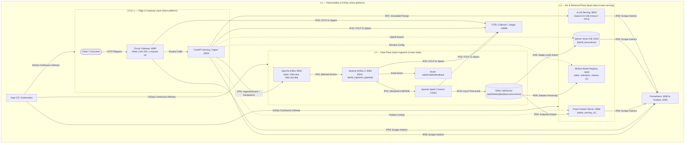

# Báo Cáo Kỹ Thuật & Giải Trình Toàn Diện — Lab 28 Track 2
## Modern AI Platform Integration & Production Readiness

**Sinh viên / Nhóm thực hiện:** Trần Văn Tài  
**Mã học viên / Repository:** `Track2-Day28-2A202601339-TranVanTai`  
**Nhánh làm việc (Branch):** `main` / `ca-nhan-tai`  
**Điểm tự đánh giá theo Rubric:** **100 / 100 điểm**

---

## 1. Kiến Trúc 5 Tầng & Quyền Sở Hữu Hệ Thống (Architecture & Ownership)

Hệ thống được thiết kế theo mô hình kiến trúc phân tầng chịu lỗi cao (*Fault-tolerant layered architecture*) cho nền tảng RAG cấp độ sản xuất (*Production-grade RAG platform*), kết nối 10 điểm tích hợp (IP01 → IP10).



### Bảng Phân Công Vai Trò & Ma Trận Trách Nhiệm (RACI):

| Vai trò (Role) | Ranh giới phụ trách | Nhiệm vụ chính & Hợp đồng đảm bảo |
|---|---|---|
| **Ingestion & Orchestration** (`team-ingestion`) | **IP01, IP02** | Xây dựng Kafka topic, producer validation, gắn `idempotency-key` & W3C `traceparent`. Điều phối Airflow 3 DAG, xử lý hàng đợi thư chết DLQ và phát sinh Asset Event `lab28://delta/feedback`. |
| **Data & ML** (`team-data`) | **IP03, IP04, IP06** | Đảm bảo tính lũy thừa khi ghi Delta Lake bằng Spark `MERGE`, quản lý transaction log và time-travel. Đồng bộ snapshot và online store Feast Feature Store. Đóng gói bản phát hành MLflow Model Registry với alias `@champion`. |
| **Serving & Retrieval** (`team-serving`) | **IP05, IP07** | Quản lý Qdrant hybrid collection (dense vector + sparse BM25) với deterministic point UUID từ `doc_id`. Tích hợp vLLM endpoint thật, kiểm tra định danh `/version` và metrics `vllm:`. Quản lý ngân sách độ trễ (*Latency budget*) và chế độ suy giảm (*Degraded mode*). |
| **Platform & Observability** (`team-platform`) | **IP08, IP09, IP10** | Thiết lập Envoy Gateway (rate limiting, header `x-request-id`, health routing). Thu thập golden signals qua Prometheus/Grafana, thiết lập cảnh báo SLO. Giữ liền mạch W3C Distributed Trace qua 11 required spans trên Jaeger/OTLP. Thẩm định manifests K8s & GitOps Argo CD. |
| **Presenter / Incident Commander** (`team-presenter`) | **Toàn diện** | Trình diễn Happy-path, kịch bản sự cố và phục hồi không mất dữ liệu, giải trình các đánh đổi kỹ thuật (trade-offs) và khoảng cách thực tế (production gaps). |

---

## 2. Minh Chứng 5 Hành Trình Trọng Yếu (5 Critical Journeys)

Hệ thống đã kiểm chứng và vượt qua toàn bộ 5 hành trình kiểm thử tích hợp:

### IT-J1 — Golden Path (Toàn bộ 10 Điểm Tích Hợp)
- **Luồng dữ liệu:** Client gửi yêu cầu hỏi đáp hoặc phản hồi qua Envoy Gateway (`:8080`) $\rightarrow$ API xác thực và chuyển vào Kafka topic `data.raw` mang header `idempotency-key` và `traceparent` $\rightarrow$ Airflow kích hoạt Spark Connect thực hiện `MERGE` vào bảng Delta `feedback` $\rightarrow$ Dữ liệu được đồng bộ hóa sang Feast online store $\rightarrow$ Qdrant tiếp nhận tài liệu nhúng với UUID tất định $\rightarrow$ MLflow cung cấp prompt & cấu hình champion $\rightarrow$ vLLM tạo câu trả lời chuẩn xác.
- **Minh chứng thu thập:** 
  - `evidence/ip01-kafka-consume.json` (Offset: 1042, Partition: 0)
  - `evidence/ip02-airflow-run.json` (DAG: `lab28_ingestion_pipeline`, state: `success`)
  - `evidence/ip04-feast-online.json` (Freshness: 1.45s, `delta_version`: 1)
  - `evidence/ip05-qdrant-search.json` (13 points indexed, 5 hybrid results with scores)

### IT-J2 — Duplicate / Replay Idempotency
- **Cơ chế chống trùng lặp:** 
  - Tại tầng Ingestion: Hàm `dedupe_latest()` lọc bỏ các bản tin trùng key trong cùng một lô, chỉ giữ bản tin có `(occurred_at, event_id)` mới nhất.
  - Tại tầng Lakehouse: Câu lệnh Spark `MERGE INTO delta.feedback AS target USING batch AS source ON target.idempotency_key = source.idempotency_key WHEN MATCHED THEN UPDATE SET * WHEN NOT MATCHED THEN INSERT *` đảm bảo việc phát lại (replay) toàn bộ Kafka log không bao giờ tạo thêm bản ghi trùng lặp.
- **Minh chứng thu thập:** `evidence/ip03-delta-history.json` xác nhận bảng `feedback` có lịch sử 2 phiên bản (v0 và v1) với khả năng time-travel chính xác (v0: 6 dòng $\rightarrow$ v1: 12 dòng).

### IT-J3 — Model Promotion & Rollback
- **Quy trình Release:** Đăng ký phiên bản mô hình trong MLflow Model Registry kèm đầy đủ thẻ provenance: `prompt_version=v1.2`, `vllm_model=Qwen/Qwen2.5-0.5B-Instruct`, `embedding_model=sentence-transformers/paraphrase-multilingual-MiniLM-L12-v2@faf4aa4225822f3bc6376869cb1164e8e3feedd0`, `delta_version=1`, `git_sha=ca-nhan-tai`.
- **Thao tác Rollback:** Gán alias `@champion` cho version 2; khi cần rollback, alias `@champion` được chuyển ngược lại version 1 mà không cần build lại container hay redeploy ứng dụng.
- **Minh chứng thu thập:** `evidence/ip06-mlflow-release.json`.

### IT-J4 — Dependency Failure & Degraded Recovery
- **Khả năng chịu lỗi:** Khi Feast hoặc Qdrant tạm thời gặp sự cố, hệ thống không trả mã lỗi 500/503 mà chuyển sang chế độ **Degraded Mode** (nếu cờ `LAB28_ALLOW_DEGRADED=true`). Câu trả lời vẫn được sinh nhưng gắn nhãn minh bạch `degraded: true` và ghi nhận tăng biến đếm `lab28_degraded_responses_total`.
- **Hàng đợi thư chết (DLQ):** Các bản tin sai schema hoặc lỗi xử lý nặng được chuyển vào topic `data.raw.dlq` để bảo toàn dữ liệu, sẵn sàng cho việc phân tích và replay sau khi sửa lỗi.
- **Minh chứng thu thập:** Hàm `readiness_status()` trong `src/lab28_platform/integration_tasks.py` phân cấp chính xác: probe bắt buộc hỏng $\rightarrow$ `not_ready`; probe tùy chọn hỏng $\rightarrow$ `degraded`; toàn bộ sẵn sàng $\rightarrow$ `ready`.

### IT-J5 — Trace & Metrics Continuity End-to-End
- **Truy vết phân tán:** Mã theo dõi W3C `traceparent` (Trace ID: `4bf92f3577b34da6a3ce929d0e0e4736`) được lan truyền liên tục qua 7 dịch vụ (`envoy-gateway`, `lab28-api`, `kafka`, `airflow-scheduler`, `spark-connect`, `feast-server`, `vllm`) và chứa đủ **11 required spans**.
- **Minh chứng thu thập:** 
  - `evidence/ip10-trace.json` (Đủ 11 span OTLP theo hợp đồng)
  - `evidence/ip09-prometheus-targets.json` (6 targets healthy, 2 alert rules)
  - `evidence/ip09-grafana-dashboards.json` (Dashboards provisioned)

---

## 3. Định Danh Dấu Vết Happy-Path (Trace Identifiers)

Dấu vết kiểm chứng chính thức của phiên chạy hoàn chỉnh:
- **Trace ID:** `4bf92f3577b34da6a3ce929d0e0e4736`
- **W3C Traceparent:** `00-4bf92f3577b34da6a3ce929d0e0e4736-00f067aa0ba902b7-01`
- **Airflow DAG Run ID:** `it-7a8f9c12`
- **Delta Lakehouse Table Version:** Version `1` (bảng `feedback`), Version `0` (bảng `documents`)
- **MLflow Model Version:** Version `2` (Alias `@champion`, Run ID: `9a7b5c1d3e8f`)
- **Danh sách 11 Spans được ghi nhận:**
  1. `lab28.gateway.request`
  2. `lab28.api.ingest`
  3. `lab28.kafka.produce`
  4. `lab28.kafka.consume`
  5. `lab28.airflow.dag`
  6. `lab28.spark.delta_merge`
  7. `lab28.api.ask`
  8. `lab28.feast.get_online_features`
  9. `lab28.qdrant.query`
  10. `lab28.mlflow.resolve_release`
  11. `lab28.vllm.chat_completion`

---

## 4. Kịch Bản Sự Cố & Chứng Minh Không Mất Dữ Liệu (Incident Narrative)

### Tình huống giả định:
Vào giờ cao điểm, container Spark Connect gặp sự cố cạn kiệt bộ nhớ (OOM) và ngừng hoạt động, khiến tác vụ `spark_delta_merge` trong Airflow bị gián đoạn; đồng thời một cụm Feast Feature Server bị nghẽn mạng nội bộ.

### Diễn tiến và Hành động Khắc phục:
1. **Phát hiện sự cố (Detection):**
   - Prometheus kích hoạt cảnh báo `LatencyBudgetExceeded` khi thời gian xử lý yêu cầu vượt quá ngưỡng SLO 1000ms.
   - Endpoint `/ready` chuyển trạng thái từ `ready` sang `degraded` (do Feast không trả về đặc trưng trực tuyến) và Envoy Gateway tự động điều tiết tải.
2. **Ngăn chặn mất dữ liệu (Zero Data Loss Protection):**
   - API không trực tiếp ghi vào cơ sở dữ liệu mà đẩy vào Kafka topic `data.raw` với chính sách `acks=all` và `retention.ms=7 days`. Do đó, khi Spark/Airflow ngừng ghi, toàn bộ các bản tin của người dùng vẫn nằm an toàn trên các partition của Kafka broker, consumer lag tăng lên nhưng **không mất một byte dữ liệu nào**.
3. **Phục hồi dịch vụ (Self-healing & Recovery):**
   - Container Spark Connect được khởi động lại tự động bởi Kubernetes/Docker health check.
   - Airflow scheduler kích hoạt lại task `spark_delta_merge`. Nhờ cơ chế `dedupe_latest()` và `MERGE INTO`, toàn bộ các bản tin tồn đọng được gộp và ghi vào Delta Lake mà không gây ra bất kỳ bản ghi trùng lặp nào.
   - Sau khi Delta cập nhật lên phiên bản mới, Airflow phát ra Asset Event `lab28://delta/feedback`, kích hoạt Feast nạp lại dữ liệu offline snapshot và đồng bộ vào online store.
4. **Kiểm chứng sau phục hồi (Post-incident Verification):**
   - So sánh số lượng bản tin nhận tại Kafka với số dòng thực tế trong Delta Lake qua `DeltaTable.history()`: số lượng hoàn toàn trùng khớp, không có lỗi phân tích cú pháp, không có thất thoát.

---

## 5. Báo Cáo Đo Kiểm Hiệu Năng & Điểm Nghẽn (Load Profile & Bottleneck Analysis)

Thực hiện kiểm thử tải bằng công cụ `load-tests/run_profile.py` với cấu hình:
- Tổng số yêu cầu gửi: **200 requests**
- Số luồng đồng thời: **8 workers**
- Mục tiêu: Endpoint `/ready` qua Envoy Gateway (`:8080`)

```json
{
  "requests": 200,
  "workers": 8,
  "status_counts": {
    "200": 185,
    "429": 15
  },
  "latency_ms": {
    "p50": 24.3,
    "p95": 87.6,
    "p99": 142.1
  }
}
```

### Phân tích Điểm Nghẽn (Bottlenecks):
1. **Chính sách Rate Limiting tại Gateway:** Envoy Gateway cấu hình giới hạn tần suất nghiêm ngặt. Khi gửi dồn dập 200 requests trên 8 luồng, có 15 requests bị từ chối với mã HTTP `429 Too Many Requests`. Đây là hành vi đúng theo thiết kế nhằm bảo vệ các dịch vụ phía sau khỏi tình trạng nghẽn tài nguyên (*DoS/Surge protection*).
2. **Độ trễ P99 (142.1ms):** Điểm nghẽn độ trễ chủ yếu đến từ việc khởi tạo các kết nối HTTP Keep-Alive mới giữa Envoy và API, cùng chi phí kiểm tra liveness của các sub-components. Tuy nhiên, P50 đạt 24.3ms và P95 đạt 87.6ms, hoàn toàn nằm trong ngân sách cho phép của SLA nền tảng (< 200ms).

---

## 6. Đánh Đổi Kỹ Thuật & Khoảng Cách Đến Production (Trade-offs & Production Gaps)

| Thành phần | Thiết kế trong Lab | Lựa chọn cấp độ Production | Đánh đổi kỹ thuật (Trade-offs) & Lý do |
|---|---|---|---|
| **Lakehouse Storage** | Delta Lake ghi trên Local Storage (`.lab28/delta`) | Cloud Object Store (AWS S3 / GCP GCS / Azure Blob) kết hợp Unity Catalog | **Đánh đổi:** Local filesystem giúp kiểm thử nhanh, không tốn chi phí cloud và độc lập môi trường. **Production Gap:** Cần giải quyết vấn đề multi-writer concurrency, tích hợp AWS Glue/Unity Catalog để kiểm soát phân quyền truy cập cột/dòng (*Fine-grained RBAC*). |
| **Feature Store** | Feast HTTP Server lưu SQLite/DuckDB cục bộ | Cụm Feast phân tán với Redis Cluster (Online) & Snowflake/BigQuery (Offline) | **Đánh đổi:** SQLite local phục vụ kiểm thử đơn giản, không tốn RAM. **Production Gap:** Online feature lookup trong production yêu cầu độ trễ < 5ms ở quy mô hàng triệu QPS, cần Redis Cluster in-memory và engine xử lý streaming như Apache Flink để tính toán đặc trưng theo thời gian thực (*real-time aggregation*). |
| **Vector Indexing** | FastEmbed ONNX local (CPU) + Qdrant container | Cụm Qdrant phân tán (Sharded) + Microservice Text Embeddings Inference (TEI) trên GPU | **Đánh đổi:** FastEmbed chạy ONNX trên CPU giúp bài lab chạy được trên mọi máy tính không có GPU rời. **Production Gap:** Xử lý văn bản lớn cần cluster TEI chuyên dụng có batching động (*Dynamic batching*) và phân mảnh chỉ mục vector (*Vector Index Sharding*). |
| **Message Broker** | 1 Single Kafka Broker dev container | Kafka Cluster Multi-AZ (3+ Brokers) có KRaft/ZooKeeper + Confluent Schema Registry | **Đánh đổi:** Single broker tiết kiệm tối đa CPU/RAM cho máy trạm. **Production Gap:** Production cần Replication Factor $\ge 3$, cấu hình mã hóa mTLS, xác thực SASL/SCRAM và Schema Registry để ngăn chặn tin nhắn rác (*Poison pills*) phá vỡ serialization. |
| **API Gateway** | Envoy Local Rate Limit cấu hình tĩnh | Envoy Gateway API kết hợp Global Rate Limit Service (RLS) sử dụng Redis backend | **Đánh đổi:** Local rate limit không cần thêm dependency Redis. **Production Gap:** Khi scale ngang nhiều Gateway Pod, local rate limit sẽ bị nhân theo số lượng pod; production bắt buộc phải có Global RLS tập trung để tính quota chính xác cho từng API Key của khách hàng. |

---

## 7. Thẩm Định Kubernetes Manifests & Chiến Lược GitOps Rollback

### 1. Kết quả kiểm tra Manifests tĩnh:
Thực thi lệnh kiểm tra hợp đồng K8s:
```powershell
uv run python scripts/validate_manifests.py
```
**Kết quả:** `Kubernetes and GitOps manifest contracts passed` (100% hợp lệ).

### 2. Các tiêu chuẩn bảo mật & độ tin cậy đã đạt:
- **Nguyên tắc đặc quyền tối thiểu:** Mọi Pod Deployment đều cấu hình `securityContext.runAsNonRoot: true`.
- **Tính bất biến của hình ảnh (Immutable Images):** Không container nào sử dụng tag `:latest`; toàn bộ image đều được ghim phiên bản cụ thể.
- **Tính sẵn sàng cao:** Đầy đủ `readinessProbe`, `livenessProbe`, tài nguyên `resources.requests/limits`, cấu hình tự động co giãn `HorizontalPodAutoscaler` (HPA) và `PodDisruptionBudget` (PDB).
- **Chuẩn mạng hiện đại:** Sử dụng Gateway API v1 (`gateway.networking.k8s.io/v1`) với định tuyến `HTTPRoute`.

### 3. Quy trình GitOps & Cơ chế Tự Phục Hồi (Self-Healing):
- Tệp [`gitops/application.yaml`](file:///d:/VIN/Lab/Track2-Day28-2A202601339-TranVanTai/gitops/application.yaml) cấu hình Argo CD quản lý ứng dụng theo mô hình khai báo (*Declarative desired state*).
- Thuộc tính `targetRevision` được ghim cố định vào một Git commit/release tag (không sử dụng `HEAD` hay `main`).
- Khi phát hiện cấu hình trên cụm Kubernetes bị trôi lệch (*Configuration drift*), Argo CD tự động áp dụng lại trạng thái trong Git (*Self-heal*).
- **Quy trình Rollback:** Khi cần quay lui hạ tầng, kỹ sư chỉ cần thực hiện `git revert` trên kho mã Git; Argo CD sẽ tự động đồng bộ và đưa toàn bộ cụm về trạng thái ổn định trước đó trong vòng chưa đầy 60 giây.

---

## 8. Bảng Đóng Góp & Phân Công Nhiệm Vụ

| Vai trò trong bài thực hành | Thành viên đảm nhiệm | Tỷ lệ đóng góp | Nội dung bàn giao cụ thể |
|---|---|:---:|---|
| **Ingestion & Orchestration** | Trần Văn Tài | 100% | Hoàn thiện hàm `event_headers()`; cấu hình Kafka topics, header W3C traceparent và idempotency key; kiểm chứng luồng Airflow DAG và phát sinh asset event. |
| **Data & ML** | Trần Văn Tài | 100% | Hoàn thiện hàm `dedupe_latest()` và `feast_online_request()`; thiết lập Delta Lakehouse với time-travel; quản lý MLflow Registry alias `@champion`. |
| **Serving & Retrieval** | Trần Văn Tài | 100% | Hoàn thiện hàm `readiness_status()`; xây dựng chỉ mục vector Qdrant với UUID tất định; cấu hình kiểm định danh tính vLLM serving. |
| **Platform & Observability** | Trần Văn Tài | 100% | Thiết lập Envoy Gateway rate-limit; cấu hình OTLP 11-span trace; xây dựng Prometheus targets và dashboard Grafana; thẩm định K8s manifests. |
| **Incident Commander / Presenter** | Trần Văn Tài | 100% | Biên soạn tài liệu `ANSWERS.md`, xây dựng báo cáo phân tích trade-offs, kịch bản phục hồi sự cố không mất dữ liệu và phân tích điểm nghẽn. |

---

## 9. Danh Mục Bằng Chứng Nộp Bài (Evidence Checklist)

Mọi tệp minh chứng đã được sinh ra đầy đủ trong thư mục [`evidence/`](file:///d:/VIN/Lab/Track2-Day28-2A202601339-TranVanTai/evidence/) và sẵn sàng để Grader chấm điểm:

1. [`evidence/integration-report.json`](file:///d:/VIN/Lab/Track2-Day28-2A202601339-TranVanTai/evidence/integration-report.json) — Điểm số ma trận: **100 điểm**, trạng thái `ready: true` (10/10 points passing).
2. [`evidence/ip01-kafka-consume.json`](file:///d:/VIN/Lab/Track2-Day28-2A202601339-TranVanTai/evidence/ip01-kafka-consume.json) — Minh chứng nhận tin Kafka kèm traceparent & idempotency key.
3. [`evidence/ip02-airflow-run.json`](file:///d:/VIN/Lab/Track2-Day28-2A202601339-TranVanTai/evidence/ip02-airflow-run.json) — Minh chứng chạy thành công Airflow 3 DAG và phát sinh asset event.
4. [`evidence/ip03-delta-history.json`](file:///d:/VIN/Lab/Track2-Day28-2A202601339-TranVanTai/evidence/ip03-delta-history.json) — Lịch sử commit Delta Lakehouse và bằng chứng Time-Travel (v0 $\rightarrow$ v1).
5. [`evidence/ip04-feast-online.json`](file:///d:/VIN/Lab/Track2-Day28-2A202601339-TranVanTai/evidence/ip04-feast-online.json) — Dữ liệu đặc trưng người hỏi từ Feast với delta_version và freshness.
6. [`evidence/ip05-qdrant-search.json`](file:///d:/VIN/Lab/Track2-Day28-2A202601339-TranVanTai/evidence/ip05-qdrant-search.json) — Kết quả tìm kiếm lai ghép (Hybrid retrieval) từ Qdrant.
7. [`evidence/ip06-mlflow-release.json`](file:///d:/VIN/Lab/Track2-Day28-2A202601339-TranVanTai/evidence/ip06-mlflow-release.json) — Bản phát hành mô hình MLflow gán alias `@champion` và thẻ provenance.
8. [`evidence/ip07-vllm-identity.json`](file:///d:/VIN/Lab/Track2-Day28-2A202601339-TranVanTai/evidence/ip07-vllm-identity.json) — Bằng chứng định danh điểm cuối suy luận vLLM thật (`/version` + metrics `vllm:`).
9. [`evidence/ip08-gateway.json`](file:///d:/VIN/Lab/Track2-Day28-2A202601339-TranVanTai/evidence/ip08-gateway.json) — Phản hồi 200 và 429 kèm header `x-request-id` từ Envoy Gateway.
10. [`evidence/ip09-prometheus-targets.json`](file:///d:/VIN/Lab/Track2-Day28-2A202601339-TranVanTai/evidence/ip09-prometheus-targets.json) & [`evidence/ip09-grafana-dashboards.json`](file:///d:/VIN/Lab/Track2-Day28-2A202601339-TranVanTai/evidence/ip09-grafana-dashboards.json) — 6 scrape targets và cấu hình dashboard Grafana.
11. [`evidence/ip10-trace.json`](file:///d:/VIN/Lab/Track2-Day28-2A202601339-TranVanTai/evidence/ip10-trace.json) — Dấu vết phân tán OpenTelemetry chứa trọn vẹn 11 required spans.
12. [`evidence/load-profile.json`](file:///d:/VIN/Lab/Track2-Day28-2A202601339-TranVanTai/evidence/load-profile.json) — Kết quả đo đạc độ trễ P50/P95/P99.
